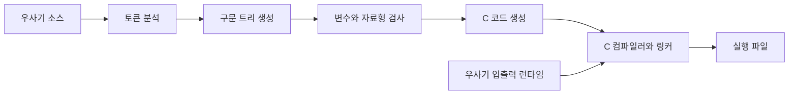

# 우사기 랭귀지 컴파일러 구현 계획

버전: 1.0.0 구현 기록  
작성일: 2026-10-16 (한국 시간)  
기준 문법: `USAGI_LANGUAGE_SPEC.md` 1.0.0 정식 · v1.0 실행 규칙  
상태: 컴파일러 1.0.0 구현 및 Windows x64 검증 완료. 먹이기 함수 인자와 에디터 진단 지원.

실제 소스와 실행 방법은 [usagi-compiler/README.md](usagi-compiler/README.md)에 있다. 정수 배열·숫자 입력·개행까지 지원하는 1.0.0으로 확장했다. VS Code 확장 소스는 `usagi-vscode`, 설치 파일은 `usagi-language-1.0.0.vsix`다.

## 1. 구현 방향

첫 버전은 **Python으로 작성한 프런트엔드가 C 코드를 생성하고, Clang이 실행 파일을 만드는 구조**로 구현했다.

우리가 구현할 부분은 우사기 소스의 문법·자료형 검사, C 코드 생성, 입출력 런타임, 빌드 명령이다. 생성된 C의 기계어 변환과 링크는 기존 C 도구에 맡긴다. 이 방식은 C를 중간 출력으로 사용하는 트랜스파일러와 빌드 드라이버를 결합한 컴파일러다.



컴파일러 작성에는 Python 3.12 이상을 기준으로 한다. C 출력은 C11을 기준으로 하고 백엔드는 Clang을 사용한다. Clang은 C 계열 소스를 컴파일하며, 완전한 실행 파일 빌드에는 링커와 대상 플랫폼의 라이브러리를 포함한 도구 체인이 필요하다. [Clang 공식 설명](https://clang.llvm.org/docs/UsersManual.html#introduction)

대상 운영체제에 맞는 도구 체인을 사용한다. 첫 검증 대상은 Windows이며, 해당 환경에서 `.exe`를 생성한다. 다른 운영체제를 위한 빌드는 각각의 환경에서 검증한다.

## 2. 현재 버전의 범위

- UTF-8 소스 파일 읽기.
- `우사기!`·`!우사기` 메인과 `우나! 하치와레: 함수명`·`우~나! 반환식` 일반 함수. 함수 경계에 중괄호 불필요.
- 인자 없는 기존 호출과 `냠! 값 … 꿀꺽!` 먹이기 호출. 선언의 `냠! 자료형 이름` 매개변수, 반환형 추론, 지역 변수, 전방 호출, 자동 변환.
- 사용자 이름의 `하치와레:` 접두사와 여러 단어 이름. `야`만 반복한 변수명은 유일하게 접두사 생략을 허용하며 함수에는 적용하지 않는다. 이름 내부 공백 정규화.
- 문자열 자료형 `하치와레!`, 리터럴 `하치! 내용 와레!`, 대입·입출력·함수 반환.
- 함수 내부의 중괄호 범위 블록과 메인 종료 코드 0 반환.
- 양수·0·음수의 `갸웃?` 분기와 독립된 반응 본문 범위.
- 시작 횟수를 고정하는 `우쨔?` 반복과 읽기 전용 `뿌야!`.
- 본문을 최소 한 번 실행하고 마지막 조건을 검사하는 `푸루룻!` 반복.
- 중첩 반복·분기와 가장 안쪽 반복의 `삐익!`·`휙!`.
- 정수형과 실수형의 변수 선언·대입.
- 확정된 정수 표기, 음수 접두사, 선택적 자리 구분자 `~`.
- 소수점 `.`. 최초 단계에서는 현재 표준 예제로 정의된 한 자리 소수부를 지원한다.
- 기본 산술 연산과 소괄호에 관한 기존 제안 문법.
- **숫자 입력 `냠?`, 문자열 입력 `하아?`, 출력 `우~라~`.** 숫자 입력은 변수형을 따르고 쉼표로 여러 대상을 받는다.
- 원래 우사기 소스의 줄·열 위치를 표시하는 오류 메시지.
- 문법 검사, C 코드 출력, 실행 파일 빌드 명령.

사용자의 함수·이름 규칙과 채택된 제어문·먹이기 인자를 반영했다. 세부 정책은 v1.0 정식 실행 규칙에 확정한다. 미지원 문법은 명확한 진단을 낸다.

문자형, 문자열 연결·일반 이스케이프·숫자 변환·여러 줄 표기, 여러 자리 소수부, 기본·가변 인자·재귀·중첩 함수·조건부 조기 반환은 대응하는 문법과 동작을 정한 뒤 추가한다.

## 3. 컴파일 단계

| 단계 | 해야 할 일 | 결과 |
|---|---|---|
| 소스 읽기 | UTF-8로 읽고 원래 위치를 보존 | 소스 텍스트 |
| 토큰 분석 | 키워드·변수·숫자·기호 구분 | 위치 정보가 있는 토큰 |
| 구문 분석 | 문장과 연산 우선순위를 분석 | 우사기 구문 트리(AST) |
| 의미 분석 | 선언·자료형·대입 대상·블록 검사 | 검증된 구문 트리 |
| C 생성 | 변수 이름 변환, 식·문장·런타임 호출 생성 | `.c` 파일 |
| 빌드 | C 컴파일러와 링커 실행 | 대상 환경의 실행 파일 |

### 3.1 토큰과 숫자 분석

소리를 단순 문자열 치환으로 C에 바꾸지 않는다. 먼저 정확한 토큰으로 나누고 숫자를 해석한다.

- 예약어는 정확한 전체 표기로 구별한다. `하아?`와 `하아!`, `핫!`과 `하핫!`, `야하!`와 `야~하!`가 서로 섞이지 않아야 한다.
- 공백으로 구분한 전체 토큰을 정확히 대조한다. 예약어를 부분 문자열로 분해하거나 대체하지 않는다.
- 문자열 시작을 만나면 닫는 `와레!`까지 별도로 읽어 내부 키워드는 보존하되 우이!만 개행으로 해석한다. 현재 한 줄 리터럴, 구분 공백 최대 하나씩 제외, 나머지 공백 보존 규칙을 적용한다.
- `하치와레:` 뒤의 같은 줄 이름을 다음 문법 토큰 전까지 읽고 단어 사이 공백을 정규화한다. 접두사 없는 `야` 반복 이름은 별도 변수 토큰으로 읽고 선언·대입·입력·식에서 허용한다. 함수 선언과 호출은 여전히 접두사가 필요하다. 두 변수 표기의 이름은 같게 정규화한다.
- 숫자에만 허용되는 `~` 생략 규칙을 적용한다. 키워드의 물결표를 지우지 않는다.
- 백·십·일의 자리 순서와 각 계수를 해석한다. 붙여 쓴 숫자와 구분자가 있는 숫자는 같은 값이어야 한다.
- `릇뿌`는 숫자의 부호, `.`은 소수점으로 해석한다.
- 숫자의 형태가 잘못되면 해당 위치에서 숫자 문법 오류를 보고한다.

### 3.2 구문 분석과 자료형 검사

문장은 재귀 하강 방식으로 분석한다. 식은 곱하기·나누기·나머지를 먼저, 더하기·빼기를 나중에 묶는다. 같은 우선순위는 왼쪽부터 처리한다.

구문 트리는 프로그램, 함수, 반환식·호출, 블록, 선언·대입·입출력, 식에 더해 세 반응 분기, 두 반복문, 남은 횟수, 탈출·다음 차례를 표현한다. 파서는 함수와 제어문의 시작·종료·반응 표식을 각각의 경계로 처리한다. 잘못 닫힌 본문과 중복 반응은 원본 위치에서 오류를 낸다.

먼저 파일의 함수 이름을 등록한 뒤 호출 의존관계를 따라 반환형을 추론한다. 선언 위치보다 앞의 호출도 가능하다. 각 함수는 별개의 변수 범위를 갖는다. 반환형 추론 중 순환을 발견하면 재귀·상호 재귀 미지원 오류를 낸다. 호출하지 않는 함수도 정적 검사한다.

자료형 검사에서는 선언되지 않은 변수, 잘못된 입력 대상, 대입할 수 없는 자료형, 잘못 짝지어진 중괄호 등을 원래 소스 위치와 함께 보고한다. 중괄호 짝은 구문 분석 단계에서도 검사한다.

매개변수는 함수 최상위 지역 범위에 먼저 등록하고 중복을 검사한다. 호출 인자 수를 검사한 뒤 매개변수형으로 변환한다. C 함수의 인자 평가 순서에 의존하지 않도록 각 인자와 변환 결과를 왼쪽부터 임시 변수에 저장한다. 문자열도 값으로 복사한다.

제어문 조건은 숫자만 허용하고 횟수는 정수만 허용한다. 반응·반복 본문마다 새 범위를 만든다. `푸루룻?` 조건은 바깥 범위에서 검사하여 본문 선언을 건너뛰는 `휙!`에서도 미초기화 값을 읽지 않게 한다. 각 함수에 반복 스택과 횟수 반복 스택을 따로 두어 호출자의 반복 제어가 다른 함수로 넘어가지 않게 한다.

### 3.3 C 출력과 런타임

우사기 변수는 생성된 C에서 `us_v1`, 함수는 `us_f1` 같은 내부 이름을 사용한다. 모든 함수의 프로토타입을 먼저 생성한다. 호출 결과를 임시 변수에 저장하여 식의 왼쪽부터 입력·출력이 실행되는 순서를 보장한다.

대입 시 실수→정수 자동 변환은 전용 런타임 함수로 수행한다. 소수 부분은 0 방향으로 버리며 int64 범위를 먼저 검사한다. C에서 int64 최댓값을 double로 표현하면 2^63으로 반올림되므로 상한은 2^63 미만으로 검사한다.

분기 조건은 임시 값에 한 번 저장한다. 횟수 반복은 시작 값을 저장하고 0까지 감소시키며 음수 횟수는 런타임에서 거부한다. 마지막 조건 반복은 본문을 별도 범위로 감싸고 본문 뒤에서 조건식을 다시 생성·평가한다. 이 반복의 `휙!`은 조건 검사 위치로 이동하므로 조건 계산을 건너뛰지 않는다. `삐익!`은 즉시 해당 반복을 끝낸다.

입출력은 작은 C 런타임 함수로 분리한다. 예를 들어 정수 읽기·실수 읽기·정수 출력·실수 출력을 각각 담당하게 한다. 오류 처리도 이 런타임을 통해 일관되게 구현한다.

빌드 드라이버는 C 컴파일러를 인자 배열로 호출하고, 생성된 파일과 컴파일 오류를 구분한다. C 코드 생성만 요청한 경우에는 외부 C 컴파일러가 없어도 동작하도록 한다.

## 4. 현재 구현의 동작

아래 내용은 컴파일러 1.0.0의 실제 동작이다. 사용자가 정식 표준으로 확정한 동작은 USAGI_LANGUAGE_SPEC.md를 따른다. 내부 구현 구조는 호환성 계약과 구분한다.

| 항목 | v1.0 구현 |
|---|---|
| 메인 본문 | `우사기!` … `!우사기`, 중괄호 불필요, 종료 코드 0 |
| 일반 함수 | `우나! 하치와레: 함수명` … `우~나! 반환식`. 종료와 반환을 함께 수행하며 반환형 추론 |
| 함수 호출 | `함수명 냠! 값 … 꿀꺽!`과 인자 없는 기존 호출. 전방 호출과 독립 지역 범위 |
| 함수 인자 | 정수·실수·문자열 매개변수, 개수 검사, 왼쪽부터 변환·평가, 값 복사 |
| 변수 | 선언 후 사용, 같은 블록의 같은 이름 재선언은 오류 |
| 블록 | 내부 선언은 해당 블록 범위에 속함 |
| 분기 | 조건 한 번 계산, 양수·0·음수의 반응 중 하나 실행. 생략·순서 변경 허용, 중복 거부 |
| 횟수 반복 | 시작 횟수 고정, 정수만 허용, 0은 건너뜀, 음수는 실행 오류 |
| 조건 반복 | 최소 한 번 실행 후 끝 조건이 양수인 동안 반복. 조건은 바깥 범위 사용 |
| 반복 제어 | `뿌야!`는 가장 안쪽 횟수 반복, `삐익!`·`휙!`은 가장 안쪽 반복에 적용 |
| 정수 | 부호 있는 64비트, 범위를 벗어나는 계산은 오류 |
| 실수 | C `double` 기반, 출력은 유효 숫자 최대 15자리. NaN·무한대 결과는 오류 |
| 혼합 계산 | 정수와 실수를 함께 계산하면 실수로 승격 |
| 대입 변환 | 대상 변수형으로 정수↔실수 자동 변환. 실수→정수는 0 방향으로 버리고 범위 검사 |
| 정수 나눗셈 | 결과의 소수 부분을 0 방향으로 버림 |
| 정수 나머지 | 위 나눗셈에 대해 `a = q × b + r`을 만족하게 함 |
| 실수 나머지 | 첫 버전에서는 지원하지 않고 자료형 오류 |
| 산술 오류 | 0으로 나누기, 정수 오버플로 등은 실행 오류 |
| 입력 | `냠?`는 공백 구분 숫자·다중 대상, `하아?`는 문자열 한 줄 |
| 정수 배열 | `야얏! 크기 이름`, `인덱스 이름` 접근, 0 초기화·범위 검사·힙 수명 관리 |
| 개행 | 문자열 안의 `우이!`를 LF로 변환 |
| 숫자 입출력 | 소스의 우사기 숫자 표기와 별개로 일반 십진 숫자 사용 |
| 출력 | 식 하나의 값을 출력한 뒤 줄바꿈 |
| 입력 실패 | 변환 실패·범위 초과·입력 종료를 실행 오류로 보고 |

C의 동작을 그대로 노출하지 않도록 정수 계산에는 범위 검사를 넣었다. 특히 최소 정수를 −1로 나누거나 나머지를 구하는 경우도 오류로 처리한다. 실수의 비유한 결과는 오류이며, 계산 언더플로는 C double의 결과를 따른다. 입력 변환이 ERANGE를 보고하면 오류다.

문자열 입력은 줄 끝의 개행만 제거하고 앞뒤 공백·빈 줄을 보존한다. 문자열은 UTF-8 4,095바이트까지의 고정 용량 값으로 구현하며 대입·반환 시 복사한다. 생성 C 문자열은 UTF-8 바이트를 고정 길이 8진 이스케이프로 인코딩하여 따옴표·역슬래시·C 구문이 원본 내용을 바꾸지 못하게 한다. Windows 콘솔은 Unicode API, 파일·파이프는 UTF-8 바이트로 처리한다. 문자형은 별도로 설계한다.

## 5. 파일 구성과 명령

소스 확장자는 `.usagi`다. 프로젝트 폴더에서 별도 패키지 설치 없이 아래 명령을 실행한다. 선택적으로 패키지를 설치하면 `usagic` 진입점도 제공한다.

```text
py -m usagi check example.usagi
py -m usagi emit-c example.usagi -o example.c
py -m usagi build example.usagi -o example.exe
py -m usagi run example.usagi
```

`check`는 문법·자료형 검사만 수행한다. `emit-c`는 C 코드를 저장하고, `build`는 실행 파일까지 만든다. `run`은 임시 빌드 후 실행한다. 명령행 옵션은 Python 표준 라이브러리의 `argparse`로 구현할 수 있다. [Python 공식 문서](https://docs.python.org/3/library/argparse.html)

실제 소스 구성 (`usagi-compiler` 폴더):

```text
usagi/
    __init__.py
    __main__.py
    compiler.py
    numbers.py
    cli.py
    toolchain.py
    runtime.c
examples/
    input_plus_one.usagi
tests/
    test_compiler.py
pyproject.toml
README.md
```

## 6. 첫 완성 기준

다음 프로그램의 실제 빌드·실행을 첫 목표로 삼았고 완료했다. 0.3에서는 메인 표기를 변경하고 필수 중괄호 없이 동작한다.

```text
우사기!
    얏! 하치와레: 야 뿌 야하!
    냠? 하치와레: 야 야하!
    우~라~ 하치와레: 야 하! 뿌르 야하!
!우사기
```

실행 중 `4`와 엔터를 입력하면 `5`와 줄바꿈을 출력하고 종료 코드 0으로 끝나야 한다.

검증은 다음 순서로 진행한다.

1. 숫자 해석과 `~` 유무의 동치, 음수·소수 예제 확인.
2. 예약어 충돌과 연산 우선순위, 중괄호 짝, 오류 위치 확인.
3. C 출력 파일 검토와 C 컴파일 성공 확인.
4. 실제 실행 파일에 표준 입력을 전달하고 출력·종료 코드 확인.
5. 잘못된 숫자 입력, 0으로 나누기, 범위 초과에 대한 오류 확인.

v1.0에서는 함수 인자·문자열·분기·두 반복·탈출·다음 차례가 실제로 동작한다. 이후 문자형, 문자열 확장, 여러 자리 소수부, 비교·논리 연산 등의 문법을 정하며 확장한다.

## 7. 현재 확인된 환경

- 이 작업 환경의 번들 Python은 3.12.14다.
- 사용자는 별도 Python 설치 및 VS Code의 Python 확장·인터프리터 선택을 완료했다고 확인했다. 사용자 설치 Python의 버전은 이 실행 환경에서 직접 확인하지 않았다.
- 2026-10-16에 Visual Studio Build Tools 2026의 설치 완료 상태를 확인했다. 설치 버전은 18.11.12306.390이며 재부팅 필요 상태는 아니었다.
- 설치된 Clang은 22.1.3이며 대상은 `x86_64-pc-windows-msvc`다.
- Clang 실행 파일은 `C:\Program Files (x86)\Microsoft Visual Studio\18\BuildTools\VC\Tools\Llvm\x64\bin\clang.exe`에서 확인했다.
- 이 실행 파일의 전체 경로로 C11 소스를 컴파일하고 링크하는 데 성공했다. 사용 옵션은 `-std=c11 -Wall -Wextra -Werror`다.
- 생성된 실행 파일에 표준 입력으로 `4`를 전달했을 때 표준 출력 `5`, 종료 코드 0을 확인했다. 이로써 C 컴파일러·링커·필요 라이브러리의 기본 빌드 및 실행 경로를 검증했다.
- `usagi-compiler`에 소스, C 런타임, 예제 13개, 자동 테스트가 있다. 새 인자 예제는 `feeding_arguments.usagi`다.
- 전체 123개 테스트가 모두 통과했다. 건너뛴 테스트는 없다. 네이티브 테스트는 실제 실행 파일 67개를 빌드하고 기존 언어 기능과 인자·범위·복사·형 변환·평가 순서를 검증한다.
- 실제 무한 반복 프로그램 실행에 중단 예외를 주입하여 `run`이 자식 프로세스를 종료하고 임시 폴더를 정리하는 것을 확인했다. 실제 키보드 Ctrl+C 조작을 자동화한 검증은 아니다.
- `usagi build` 경로로 `examples/input_plus_one.usagi`를 `build/input_plus_one.exe`로 생성했다. 같은 소스의 네이티브 테스트에서 입력 `4` → 출력 `5`, 종료 코드 0을 확인했다.
- `examples/functions.usagi`의 실수 반환값을 정수·실수 변수에 각각 대입해 `3`, `3.2`를 출력하는 것을 네이티브 테스트로 확인했다. 뒤에 선언된 함수 호출, 호출 순서, 단독 호출 후 메인 복귀, 변환 범위 초과도 검증했다.
- 문자열의 한글·이모지·따옴표·역슬래시 보존, 빈 문자열·공백 입력, 값 복사와 함수 반환, 바이트 길이 제한, 사용자 이름 접두사 누락과 여러 단어 이름을 검증했다. Windows 대화형 콘솔 분기는 빌드했지만 실제 VS Code 콘솔 상호작용은 검증하지 않았다.
- 문자형·문자열 연결·일반 이스케이프·숫자 변환·여러 줄 리터럴·소스의 여러 자리 소수부·기본·가변 인자·재귀·중첩 함수·조건부 조기 반환은 미지원이다. 선택적인 pip 설치와 다른 운영체제에서의 빌드는 이번 검증 범위에 포함하지 않았다.

## 8. VS Code 확장

컴파일러 소스와 C 런타임을 VSIX에 포함한다. Python 3.12와 Clang 등 외부 실행 도구는 별도 설치가 필요하다. 구문 강조 규칙은 컴파일러 예약어에서 생성하며 코드 조각·키워드 도움말·실행·검사·C 생성·빌드 명령을 제공한다.

편집 진단은 `check 파일 --stdin --json`으로 저장 전 소스를 넘긴다. Python은 격리 모드로 실행하고 셸 문자열을 만들지 않는다. 이전 검사 프로세스를 취소하고 문서 버전을 비교하여 오래된 진단을 버린다. 줄·열은 VS Code의 UTF-16 위치로 변환한다. 실행은 명시적인 명령과 ProcessExecution 작업으로만 수행하며 입력 터미널을 제공한다. 신뢰하지 않은 작업 영역에서는 Python 검사·실행을 하지 않는다.

Node/TextMate 테스트 9개를 통과했다. VSIX를 별도 폴더에 설치하고 VS Code 1.141.1의 실제 확장 호스트에서 명령·도움말·편집 진단·C 생성·빌드·실행·새 파일을 검증했다. Python 격리 모드가 Windows 기본 인코딩을 사용하므로 `-X utf8`을 명시했다. 기존 VS Code 설치의 권한과 업데이트 잠금 문제는 별도 테스트 복사본·프로필에서 검증하여 해결했으며, 사용자 설치의 설정은 변경하지 않았다.

빌드 드라이버는 명시적인 `--cc`, `USAGI_CC`, PATH, `vswhere` 순서로 Clang을 찾는다. 현재 검증은 PATH를 수정하지 않고 수행했다. 생성 C는 런타임을 포함하므로 별도 사용자 헤더 없이 컴파일할 수 있다.

## v1.0 구현 추가 사항

새 숫자 입력과 문자열 입력은 하나의 커서를 공유합니다. 숫자 토큰을 읽은 줄에 남은 값이 있으면 문자열 입력 전환 시 오류를 냅니다. 숫자 줄을 모두 소비하면 다음 문자열 입력은 빈 줄을 포함한 다음 실제 줄을 받습니다.

배열 크기는 실행 시 정수식으로 계산하며 0 기반·0 초기화입니다. 인덱스 원소는 산술보다 먼저 묶이고 복합 인덱스는 괄호로 묶습니다. 함수별 힙 배열 목록과 블록별 체크포인트로 정상 종료·탈출·다음 차례·반환 시 해제합니다. 배열 전체 복사·인자·반환은 미지원입니다.

## v1.0 정식 배포

0.6 개발 구현의 동작을 유지하면서 표준의 제안·미정 상태를 정리하고 지원 규칙과 미지원 기능을 구분했다. 언어 표준·컴파일러·확장 버전은 1.0.0이다. 공개 GitHub 릴리스는 v1.0.0 태그의 소스와 VSIX·SHA-256을 제공하며 이후 호환성 정책을 적용한다.
